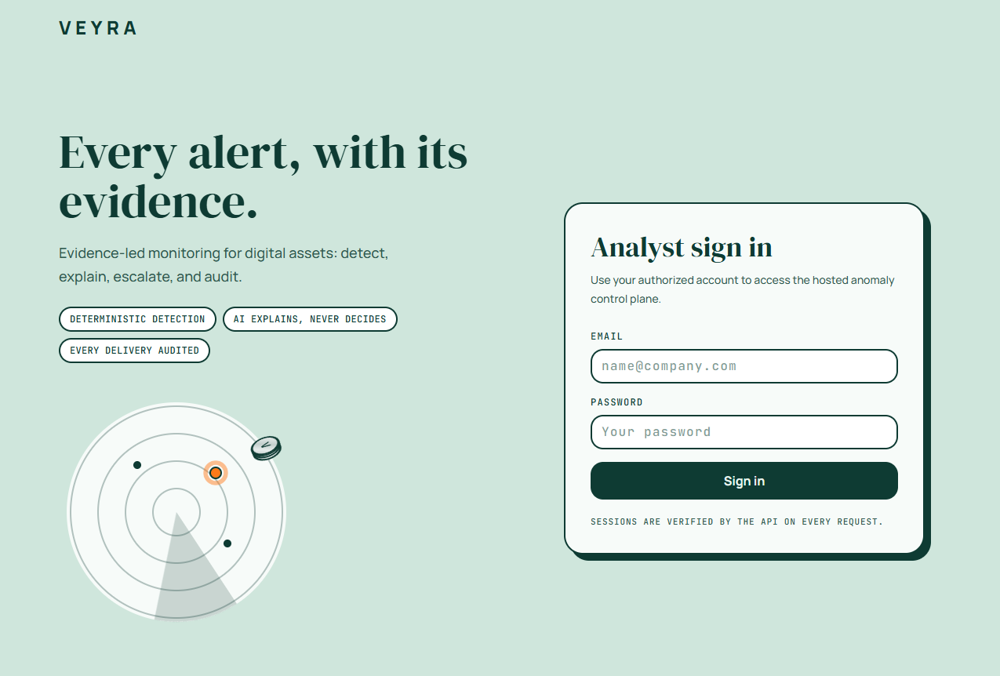
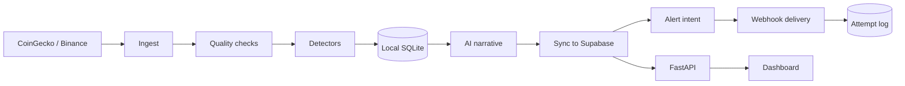

# Veyra

**Crypto anomaly monitoring with plain statistical detectors, AI explanations and an audited alert trail.**

Veyra polls BTC, ETH and USDT prices from CoinGecko and Binance, checks the data quality, and flags anomalies with z-score, IQR and stablecoin peg-deviation rules. Only after a finding exists does an LLM (Groq, with OpenRouter as fallback) write a short explanation for it. The model never decides whether something is an anomaly. Each alert gets an idempotency key, so the same anomaly cannot create two alerts, and every webhook delivery attempt is stored as its own row.

## Live demo

**https://anomaly-plum.vercel.app/** (sign-in required)



## Features

- Price ingestion for BTC, ETH and USDT with provider failover between CoinGecko and Binance
- Data-quality flags for cross-source price divergence (above 0.5%) and polling gaps
- Three deterministic detectors: z-score (threshold 3.0) and IQR (1.5x fences) on period-over-period returns, plus USDT peg deviation (above 0.5% from $1.00)
- Narratives generated only for real findings, with the model's JSON output validated before it is stored
- Idempotent alerts keyed by `anomaly_id:alert_type:channel`, delivered to a Slack webhook with bounded retries
- Alert states `pending → sending → sent / failed → acknowledged`, with every delivery attempt kept for review

## Architecture



| Stage | What happens |
|-------|--------------|
| Ingest | Fetch prices and fall back to the second provider if one fails |
| Quality checks | Flag source divergence and polling gaps |
| Detectors | Run z-score, IQR and peg-deviation checks and store the evidence |
| AI narrative | Explain each finding with Groq, or OpenRouter if Groq fails |
| Sync | Copy runs, readings, findings and narratives to Supabase PostgreSQL |
| Alert intent | Create one alert per anomaly, alert type and channel |
| Delivery | Send to the webhook, retry within a limit, and log every attempt |
| Dashboard | Show runs, findings, narratives, alerts and attempts after sign-in |

## Data

The pipeline polls BTC, ETH and USDT prices and stores them in a local SQLite file under `pipeline/data/`. Each cycle is synced to Supabase PostgreSQL, which holds pipeline runs, readings, quality flags, anomalies, narratives, alerts and delivery attempts as separate tables.

## Tech stack

| Layer | Technology |
|-------|------------|
| Pipeline | Python 3.11 |
| API | FastAPI, asyncpg, PyJWT, uvicorn |
| Database | SQLite (local), Supabase PostgreSQL |
| Auth | Supabase Auth |
| Dashboard | React, Vite, TypeScript, Tailwind |
| AI | Groq, OpenRouter (fallback) |
| Alerts | Slack webhook |
| Hosting | Vercel, Render |
| Scheduling | GitHub Actions |

## Deployment

The dashboard runs on Vercel and the API runs on Render, deployed from `main`. A GitHub Actions workflow runs one monitoring cycle every 15 minutes and keeps the pipeline history in the Actions cache between runs. Data is stored in Supabase.

## Quickstart

```powershell
git clone https://github.com/amshutha07-cmd/anomaly.git
cd anomaly

# backend
python -m venv venv
.\venv\Scripts\Activate.ps1
python -m pip install -r requirements.txt
copy .env.example .env
cd hosted\api
python -m uvicorn app.main:app --port 8000 --env-file ..\..\.env

# dashboard (second terminal, from the repo root)
cd hosted\dashboard
copy .env.example .env
pnpm install
pnpm exec vite
```

Fill in both `.env` files first. You need a Supabase project: run `hosted/database/001_initial.sql`, then `hosted/api/sql/module5b_migration.sql`, and create one user in Supabase Auth to sign in with. The dashboard opens at `http://localhost:5173`.

## Project structure

```
.
├── pipeline/            ingest, quality checks, detectors, narratives, SQLite storage
├── hosted/
│   ├── api/             FastAPI app, alert delivery, SQL migration, sync and cycle tools, tests
│   ├── dashboard/       React + Vite dashboard
│   └── database/        initial PostgreSQL schema
├── .github/workflows/   15-minute monitoring cycle
├── docs/                project notes
└── requirements.txt     Python dependencies
```

## Notes

- The dashboard and the data routes of the API require a Supabase sign-in.
- The API runs on a free Render instance, so the first request after idle can take 50 seconds or more.
- Veyra monitors and alerts only. It does not trade or predict prices.
- Keep `.env` files, API keys and webhook URLs out of version control.

## License

MIT. See [LICENSE](LICENSE).